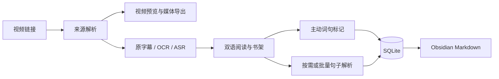

# 架构与数据流

## 一条完整学习路径

## 模块职责

| 层 | 文件 | 职责 |
|---|---|---|
| 桌面入口 | `run.py`, `local_tool/app.py` | Tkinter 操作入口、素材历史、后台事件与模型设置 |
| 配置 | `paths.py` | 数据、模型、导出库等路径；不包含个人账号 |
| 视频来源 | `media_core.py` | 平台公开页面适配、yt-dlp、媒体选择与下载 |
| 媒体处理 | `media_exports.py`, `media_ranges.py` | 完整视频、精确选段、音频、字幕导出与范围校验 |
| 预览服务 | `preview_server.py`, `preview.html` | 本机临时网页、流式转发、Range 请求、同源校验 |
| 字幕加工 | `subtitle_pipeline.py`, `transcription.py`, `learning_text.py` | 共享独立导出与学习提取、来源完整性检查、OCR、ASR、时间对齐与保守分段 |
| 学习任务 | `learning_jobs.py`, `learning_model.py` | 可恢复双语任务、队列、批量解析与模型会话复用 |
| 阅读呈现 | `reading.html`, `reading-room.css`, `reading-selection.js` | 杂志长文布局、目录、选区与视频／原文往返 |
| 书架与收藏 | `shelf.html`, `shelf.js`, `reading_marks.py` | 英语素材书架、词句总库、语境来源与 Markdown 导出 |
| 数据归档 | `media_library.py` | 素材去重、SQLite、资产路径、用户编辑保护 |

路径在 `local_tool/` 内时文件名均相对该目录。

## 数据所有权

- `materials` 保存来源、稳定平台标识和英语分类。临时签名视频流不写入这张表。
- `assets` 保存本机资产位置；`learning` 保存阅读文稿；`cache` 保存处理状态与可复用结果。
- `reading_marks` 保存具体选区、完整语境、素材与句段 ID、显示编号、视频位置和创建时间。
- 用户标记不依赖模型。相同选区去重，相同词在不同素材中保留多个语境；原文更新后旧标记不强行贴到新文本。
- SQLite 先提交，再生成 Markdown。导出失败时标记仍保留，并报告导出状态。
- 对已由用户编辑的 Markdown 留存版本；不存在自动把 Obsidian 内容覆盖回数据库的双向同步。

## 接口边界

网页通过本机 token 路径读取书架、字幕、状态和媒体；写请求要求匹配 Origin。书架恢复已保存文稿不请求视频平台，切回视频时按需刷新过期播放地址。桌面关闭后本机服务停止，网页地址可能失效，重开后从书架进入。

前端没有远端账户、社交系统或集中托管数据库。GitHub 托管源码，不托管个人学习数据。

“只提取字幕”始终走独立导出入口，网页与桌面不因英语分类而更换按钮行为或自动跳转。成功保存 TXT 后，仅英语分类素材复用同一份带时间的结果生成学习文稿。识别方式、字幕区域和分类分别传递，分类变更完成后才提交网页导出请求。

自动模式分别验证平台中英字幕。学习素材的画面识别先试读不同时间段；词汇释义不作译文，静态标题的显示时长不作语音覆盖证据。旧缓存不合格时重新定位，必要时检查底部区域；断点仅在识别区域一致时复用。画面内容不足才回退原声。分段限制时间和长度，避免缺少标点造成几分钟合成一个句段。上述检查识别明显缺失，不能证明文字零错误。

## 后续修改原则

先验证对具体学习操作的作用，再增加界面。保持来源可追溯、标记锚点稳定、数据库向前兼容。语言准确度、网络可用性、页面交互和持久化分别验收；任何一种通过都不能代替其他验证。
